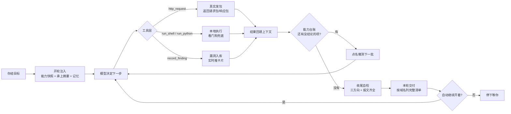
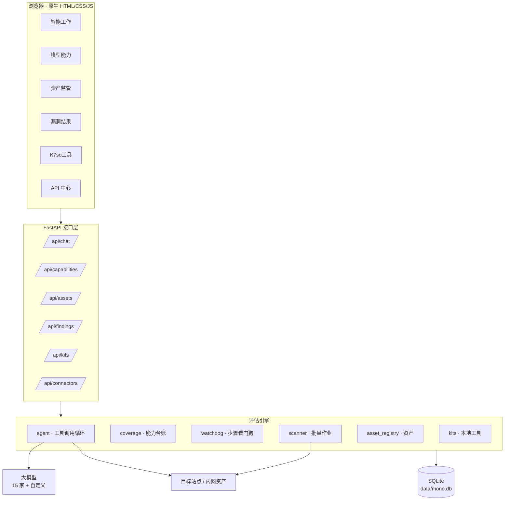

<div align="center">

# K7so · 智能安全评估平台

**给它一个域名或 IP，它自己抓首页、读前端 JS、理接口、按权重逐项验漏洞。**
**每一步留一条人话进展，每个漏洞按「标题 + URL + 逐步请求/响应包 + 修复方案」交付。**


本地单机部署 · 数据不出机器 · 无云依赖 · 原生前端

</div>

---

> **合规声明**：本平台仅用于**已取得合法授权**的资产安全评估。登录时确认的免责声明即为操作授权依据，平台会把该依据写入每个作业与审计日志。请遵守《网络安全法》《数据安全法》等相关法律法规。

## 目录

- [1. 这是什么](#1-这是什么)
- [2. 功能全景](#2-功能全景)
- [3. 快速开始](#3-快速开始)
- [4. 智能工作：核心引擎](#4-智能工作核心引擎)
- [5. 模型能力：64 项 / 7 组](#5-模型能力64-项--7-组)
- [6. 大模型接入：15 家 + 自定义](#6-大模型接入15-家--自定义)
- [7. 资产监管](#7-资产监管)
- [8. 漏洞结果](#8-漏洞结果)
- [9. K7so工具：本地脚本运行器](#9-k7so工具本地脚本运行器)
- [10. API 中心：28 个连接器](#10-api-中心28-个连接器)
- [11. 仪表盘 / 批量作业 / 审计 / 设置](#11-仪表盘--批量作业--审计--设置)
- [12. 配置：环境变量总表](#12-配置环境变量总表)
- [13. 架构与目录结构](#13-架构与目录结构)
- [14. 测试](#14-测试)
- [15. 常见问题](#15-常见问题)
- [16. 安全边界与合规](#16-安全边界与合规)
- [17. 第三方组件与商标](#17-第三方组件与商标)
- [18. 贡献](#18-贡献)
- [19. 许可证](#19-许可证)

---

## 1. 这是什么

K7so 是一个**本地单机运行的 AI 安全评估工作台**。它不是「填表 → 点扫描 → 等报告」的传统扫描器，而是一个**能自己动手的智能体**：

- 你只说目标和意图（「帮我把 shop.example.com 看一遍」「把能力清单测完」），不用选模块、不用配策略、不用点下一步；
- 它自己抓首页、读前端 JS、从路由与打包产物里理出接口和参数，再按你勾选的能力与权重逐项验证；
- 它有三把真工具：跑命令、跑 Python 脚本、发原始 HTTP 请求——**不是只会在对话框里给建议**；
- 每一步都留一条「已…，接下来…」的进展，翻回去就是完整执行过程；
- 每一轮收尾按**域名**交付漏洞清单，每条漏洞带逐步复现的请求包与响应包，照着能自己走一遍；
- 只有两件事会打断你：**要读敏感信息**、**要删东西**。其余全部自己决定。

### 三条设计原则

| 原则 | 落地方式 |
| --- | --- |
| **说目标，不点菜单** | 对话即控制台。目标、范围、手法由模型判断，测试顺序自己定，不抛「先测哪一类」的选择题回给用户 |
| **结论优先，过程可查** | 对话正文只写结论与关键判断；过程沉淀为逐条进展；证据（报文）落在漏洞记录里，随时展开 |
| **不打扰，但有红线** | 登记资产、发包、跑命令、写报告一律直接执行；读凭据、删数据先问一次；改业务数据、压测、爆破、落地后门、横向移动直接拒绝 |

### 适合 / 不适合

| 适合 | 不适合 |
| --- | --- |
| 授权范围内的 Web 资产体检、接口越权与未授权验证、漏洞复现材料整理 | 未授权目标的任何探测 |
| 把「一堆域名」变成可对比的资产台账，跟踪每月新增 | 大流量压测、DoS、密码爆破 |
| 需要「能照着复现」的漏洞报告（甲方/内部工单） | 免杀、持久化、横向渗透、凭据窃取 |
| 内网/离线环境（数据不出机器） | 多租户 SaaS（当前为单机单用户模型） |

---

## 2. 功能全景

10 个页面，每个页面解决一件事：

| 页面 | 定位 | 一句话说明 |
| --- | --- | --- |
| **智能工作** | 核心 | 对话派活，AI 自己调工具干活，逐条进展 + 漏洞实时上屏 |
| **模型能力** | 范围 | 64 项测试能力、7 个分组、1–5 权重、每项可写「用户提示」、自动渗透开关 |
| **资产监管** | 输入 | 导文件即认资产；子域收集三条路；模块按月对比新增/消失 |
| **漏洞结果** | 输出 | 以域名为单位归组，点开看 URL / 说明 / 请求包 / 响应包 |
| **K7so工具** | 扩展 | 导入 py / exe / jar / bin，点「运行」就本地跑，输出实时滚动 |
| **API 中心** | 接入 | 28 个连接器：15 家大模型 + 6 家测绘 + 情报 + 漏洞平台 + 本地工具链 |
| **仪表盘** | 总览 | 资产/作业/漏洞计数、风险分布、最近活动 |
| **批量作业** | 批处理 | 不对话也能跑：测绘 → 配置核查 → 端口 → 模板检测 → AI 研判 |
| **审计日志** | 追溯 | 谁、何时、从哪、做了什么，不可删除 |
| **设置 / 目录配置** | 调参 | 安全模式、并发、超时、UA、AI 研判、记忆目录、工作目录 |

**技术底座**：FastAPI + 原生 HTML/CSS/JS + SQLite，运行时只依赖 4 个 Python 包，前端零第三方库。

---

## 3. 快速开始

### 3.1 环境要求

- Windows / macOS / Linux
- Python **3.10+**（推荐 3.11 / 3.12）
- 可选：`nmap`、`nuclei`、`java`（不装也能跑被动侦察、内置检测与其余功能；缺什么会在界面上说清缺什么）

### 3.2 启动

**方式 A：Windows 一键**

```bat
双击 start.bat
```

首次运行自动建虚拟环境、装依赖，之后直接启动。

**方式 B：手动**

```bash
python -m venv .venv
# Windows
.venv\Scripts\activate
# macOS / Linux
source .venv/bin/activate

pip install -r requirements.txt
python run.py                             # http://127.0.0.1:8000
python run.py --host 0.0.0.0 --port 9000  # 换监听地址/端口
```

国内网络装依赖慢可加 `-i https://pypi.tuna.tsinghua.edu.cn/simple`。

### 3.3 第一次登录

1. 浏览器打开 `http://127.0.0.1:8000`；
2. 账号 `admin`，**口令是首次启动时随机生成的**——去 `data/初始口令.txt` 看，或翻启动日志里那行 `[K7so] 首次启动，已生成管理员口令：…`；
3. 阅读并同意免责声明（**拒绝即退出登录**）；
4. 进「账号」把口令改成自己的。

> 仓库里**没有任何固定口令**。想让首次启动就用指定口令（自动化部署）：
> ```bash
> K7so_ADMIN_PASSWORD='你的口令' python run.py
> ```
> Windows CMD：`set K7so_ADMIN_PASSWORD=你的口令 && python run.py`

### 3.4 五分钟上手

```text
① API 中心 → 选一家大模型 → 填 Key → 保存并检测（必须真的出一次结果才算接入）
② 模型能力 → 勾选要测的类型（默认全不勾＝完全按对话意图走；勾了就一定测完）
③ 智能工作 → 输入「帮我把 example.com 测一遍」→ 回车
④ 看进展一条条往上走；漏洞确认的瞬间对话里就出卡片
⑤ 收尾看「漏洞结果」，点开任意一条能看到分步请求包与响应包
```

---

## 4. 智能工作：核心引擎

### 4.1 一轮是怎么跑的



### 4.2 24 个内置工具

模型能做的所有事都收敛到这张表里，没有隐藏后门：

| 工具 | 用途 | 边界 |
| --- | --- | --- |
| `http_request` | 内置 HTTP 客户端（等价 `curl -i`），返回状态码/头/体 + **可归档的请求包与响应包**，支持 `note` 记录这一步目的 | 只发请求，不改数据 |
| `run_shell` | 跑外部命令（curl / nmap / nuclei / ffuf / git…），Windows 走 `cmd /d /c`，类 Unix 走 `/bin/sh -c` | 破坏性命令直接拒绝 |
| `run_python` | 直接跑 Python 脚本（`requests` / `httpx` 可用），返回输出与 traceback | 同上 |
| `record_finding` | 归档漏洞：标题、等级、URL、影响、修复建议、**请求包/响应包**、`steps` 分步过程 | 泄露类必须写对照，否则自动降档 |
| `report_capability` | 登记一项能力的验证结论（found / clean / blocked / weak） | 第一次上报先返回该项的用户提示 |
| `list_capabilities` | 重读能力快照（对话中途改了勾选才需要） | 只读 |
| `ask_choice` | 需要用户拍板时给 2–4 个可点选项 | 只在目标不明/缺凭据/超范围分支时用 |
| `platform_overview` | 一次拿全资产/作业/漏洞/能力/连接器状态 | 只读 |
| `list_assets` / `create_asset` | 查资产台账 / 登记一个目标 | 登记不打断 |
| `start_scan` / `list_scans` / `get_scan` / `cancel_scan` | 发起、查看、终止批量评估作业 | 授权依据取自免责声明 |
| `list_findings` / `update_finding_status` | 查漏洞、流转处理状态 | 只读 + 状态流转 |
| `list_connectors` / `test_connector` / `test_all_connectors` | 查连接器、检测单个、**批量并发检测** | 只读 |
| `list_dir` / `read_file` / `write_file` | 列目录（`scope=work` 工作目录 / `scope=memory` 记忆目录）、读文件、写文件 | 两个目录之外一律拒绝；记忆目录只读，只有工作目录可写 |
| `read_memory` / `search_memory` | 分页读用户级记忆（`cursor` 翻页） / 按关键词或正则定位 | 只读，文件再大也不截断 |

> **工具结果严格配对**：一条消息里发 3 个 `tool_call`，平台就按原顺序回 3 条 `role=tool`，不多不少、中间不夹别的角色。被去重跳过、参数非法、超上限的也各有明确回执——从根上避免 `tool call result does not follow tool call` 这类整轮被服务端拒绝的结构错误。

### 4.3 能力覆盖台账：勾了就一定验完

这是本平台和「随便扫扫」最大的区别：**勾选即承诺**。

- **一项一行**：`coverage_marks` 只存四种结论——`found`（有漏洞）/ `clean`（验过没问题）/ `blocked`（被目标挡住）/ `weak`（证据不足）；
- **归档自动记账**：`record_finding` 成功时自动把对应能力记成「有漏洞」；
- **硬门槛**：只要清单里还有 pending，这一轮就不算做完。哪怕三个方向都写了、动作次数也够，照样推回去重写；
- **一轮清空台账**：工具轮次预算按剩余项数现算 `max(50, 12 + pending × 8)`，上限 **1200**；
- **时长分段续期**：单轮默认 15 分钟（`K7so_TURN_MAX_SECONDS`），台账没清空时按 15 分钟一段续，兜底 **6 小时**（`K7so_LEDGER_HARD_SECONDS`），不会「第一轮 0/64、全留到第二轮」；
- **空转不设上限**：台账没清空时，自动继续的「连续空转」刹车不生效，只有点停止 / 等你拍板 / 页面断开两分钟才停；
- **「测不动」也算结论**：统一 401/403、WAF 拦截、确实没有这类入口，报 `blocked` 并写清被什么挡住，不会卡死；
- **权重决定顺序**：每项 1–5（默认 5），越大越先测；`context_text` 会排成带 `[权重 N]` 的顺序表交给模型，`list_capabilities` 也返回排好序的 `testing_order`；
- **用户提示是硬性要求**：每项可写「必须怎么测/不许碰什么」。第一次 `report_capability` 会返回 `hint_required` 与原文本（这不是失败），模型必须读完、对照检查，再用同一结论报一次才落账。

进度可视化：会话标题右侧挂一个 **58×42 的方块徽标**，上行 `已验/已勾`、下行 `还差 N`；全部有结论时变青色写「已测完」，悬停显示还差哪几项。切会话、新建会话立刻重算（新会话是 `0/N`，不会残留上一个会话的数字），运行中每 5 秒自刷。

### 4.4 承上摘要：每轮开工先「接上上一轮」

历史正文会被字数预算裁掉，而且是流水账。所以平台另做一份**结论性摘要**，开轮时注入：

- 能力台账进度、已归档漏洞（等级 + 标题 + 目标）、按时间去过重的「已经做过的动作」、上一轮结尾说的内容、**上一轮已经写过的小节标题**；
- 附硬规矩：开口只用一两句接进度；测过的入口不重测；上一轮写过的段落与漏洞清单不再抄（要引用写「（同上）」）；
- 对话里同步播一条 `承上：已验 3/64 项能力，已归档 2 条漏洞；这一轮接着做没做过的，写过的内容不再重复。`（落库、可回放）；
- **兜底去重**：与前面轮次**一字不差**且 ≥ 100 字的段落会被删除并注明「已省略」；请求包/响应包/代码块一律不动，提问轮次不裁剪。

### 4.5 收尾自检与交付门槛

模型说「结论」不算终稿，平台会先把话挂起，再让它重读记忆 + 能力清单 + 这一轮用过的工具，逐条核对后才放行：

| 门槛 | 规则 |
| --- | --- |
| **三个方向** | 高敏感信息泄露 / 控制权限 / 可造成实际危害。缺两个以上 → 推回重写，「未发现明显问题」糊不过去 |
| **动手次数** | 朝目标动手不满 18 次且零漏洞 → 推回，并给出补测顺序（未授权 → 越权 → 注入 → 文件读取 → XSS → SSRF → Nday → 弱口令 → 云存储） |
| **泄露门槛** | 登录后自己账号能看到的信息不算泄露；写不出「未登录/他人账号拿不到」的对照却标高危 → **自动降一档**并说明缺什么 |
| **必须归档** | 正文写了「高危/中危」却一条都没归档 → 先补归档再收尾 |
| **失败不是结论** | 4xx/5xx/连接失败会附 `retry_hint`（401 换身份、403 改参数位置、404 对真实路由、422 补必填、连不上查端口/协议）；连续 3 次不成功追加追问「还有哪些写法没试过」 |

### 4.6 漏洞交付格式：能照着复现

每一轮收尾都按固定结构交付，**不是最后一轮才汇总**：

```text
## 漏洞1：
## 某系统未授权访问漏洞(高危)

漏洞URL：
https://shop.example.com/api/order/1001

复现步骤：
步骤1：
请求包1：
GET /api/order/1001 HTTP/1.1
Host: shop.example.com
...
响应包1：
HTTP/1.1 200 OK
...
步骤2：
请求包2：…
响应包2：…

修复方案（50字以内）：
接口补鉴权，校验订单归属，禁止匿名读取。
```

规则细节：

- **一步一对报文**：步骤 1 的请求/响应、步骤 2 的请求/响应各自成对，互不覆盖；最后一步不能代替前面几步；
- **每步说三件事**：想验证什么 → 发出后看到什么 → 由此推出什么；
- **太长只给节选**：请求包保留到 900 字符、响应包 700 字符，断在行尾并注明完整内容见漏洞结果页；
- **按域名算，不按轮算**：这一轮只测了 a.com，就列 a.com 在这次对话里出现过的**全部**漏洞（含前几轮）；测了几个域名就各列一份；
- **换域名不串台**：这一轮只碰 b.com 就只列 b.com；纯分析无发包时退回全列；
- **判重看三样**：域名 + 标题 + URL 都相同只留最新；同标题不同 URL 是两份证据，各列各的；
- **标出新增**：本轮才归档的后面跟「（本轮新增）」；
- **步骤由真实记录兜底**：模型没写 `steps` 时，按本轮 `http_request` 的 `note` 记录自动补成步骤；一条步骤都没有会在归档返回里带 `step_gap` 当场提醒。

### 4.7 自动继续：把预设那句话一直发下去

会话记录下方一栏「自动继续」，开关与「停止生成」同一行，下面是预设词输入框（默认「继续」，改什么就发什么）。

- **判据是「有没有动手」**：发过包、跑过命令、写过文件、归档过漏洞、上报过能力，任一条就算在干活 → 接着发下一轮。只调 `list_capabilities` 这类「看一眼」的工具，或整轮只写分析文字，才算空转；
- **刹车只有三个**：① 出现要你拍板的操作；② 连续 6 轮没有实质动作（台账没清空时放宽到 12 轮，且实际不设上限）；③ 你点「停止自动」；
- **次数不设上限**，每轮收工先播「第 N 轮结束（本轮动手 N 次），正在发『继续』开始第 N+1 轮」；
- **心跳**：流里每 15 秒一次，长思考不会被代理或浏览器判死；
- **断线不等于结束**：执行与 HTTP 请求解耦，每条事件带 `seq`，前端带 `lastSeq` 自动重连 `/stream?after=N`，服务端只补漏掉的；界面写「连接断了，正在重连（第 N 次）· 后台还在跑」。刷新、切走再回来都接得上；
- **无人值守有边界**：断开超过 2 分钟，这一轮跑完不再接龙，不在后台白烧额度；
- **每处收手都留话**：「自动继续结束：<原因>（共 N 轮）」入库可回放；
- **单轮报错先重试一次**：429 / 5xx / 读超时原地重试，并提示「从中断处继续」；仍失败才收手。

### 4.8 步骤看门狗：300 秒没动静就自愈

判据是**多久没有新东西**，不是总共跑了多久：

| 场景 | 判定 | 动作 |
| --- | --- | --- |
| 模型思考 | 流式 300 秒一片都不来 | 掐断连接（不留悬挂 httpx）、写「已掐断这次请求，正在重新开始这一步」、自动重发一次；二次仍卡则终止并说明「没有继续干等」 |
| 命令 / 脚本 | 连续 300 秒零字节输出、进程还活着 | `taskkill /F /T` 连子进程收掉，返回 `stalled: true` + 「连续 N 秒没有任何输出，已判定卡死」 |
| 边跑边打印的长任务 | 一直有新输出 | **不判卡死**（默认总时长 300 秒，可显式申请到 900 秒） |
| 已退出的进程 | 进程已结束 | 不算卡死，攒下的输出照常交回 |

对话里的等待提示到 240 秒会补一句「无新进展将自动重开这一步」，提前告知平台会自己处理。

### 4.9 操作询问与不可逆红线

**只有两个平级开关**（「模型能力 → 操作询问」，默认全开，没有总开关）：

| 开关 | 管什么 |
| --- | --- |
| **读取敏感信息** | 凭据、私钥、令牌、连接串、身份证号，不论出现在文件、日志、命令输出还是接口返回；`.env` / `*.key` / `id_rsa` / 数据库文件 / 导出件，以及 `cat .env` 这类命令。命中先脱敏，再问是否看原文 |
| **删除类操作** | `rm` / `del` / `rmdir` / `unlink` / `git clean` / `drop table` / `shutil.rmtree` 这类不可逆动作，执行前问一次 |

其余操作一律直接执行：登记资产、发起/终止评估、流转风险、归档结论、写报告、执行普通命令、向任何目标发请求。

**直接拒绝、不商量**：格式化磁盘、删根目录、关机、改引导、改平台自身口令与设置、写业务数据、上传可执行文件、压测、爆破、落地持久化后门、内网横向、读取并导出凭据。

### 4.10 长回答、上下文与限流

| 项 | 默认 | 说明 |
| --- | --- | --- |
| 单次输出上限 | **16000 tokens** | 被长度截断时自动续写最多 6 段（每段提示「正在接着写（第 N 段）」）；模型嫌上限大（部分自建网关只给 4096/8192）则自动减半重试 |
| 上下文预算 | 80000 字 | 超了先压工具结果，再压历史 |
| 历史预算 | 24000 字 | 提问轮次另有一份不受裁剪的「步骤台账」 |
| 普通工具结果 | 5000 字 | 超长截头留尾并标注 |
| 命令/文件/请求结果 | 24000 字 | 同上 |
| 记忆预载 / 翻页 | 12000 / 16000 字 | 记忆总量无上限，分页读 |

**响应速度**：设置表做了进程内缓存（一次对话上下文要读三十多次设置，从约 390ms 降到 3ms 以内）；同一条消息里的多个只读工具并发执行（三个请求只花一个 RTT，结果仍按原顺序回填）。

### 4.11 提问轮次：你问一句，它答一句

「你测过 SQL 注入了吗」「所以是没发现是吗」这类话是要答案，不是派活。平台先判一次意图（问句尾 / 是不是 / 有没有 / 结论 / 刚才测了哪些，且没有「继续/帮我/再测/验一下」这类派活词），然后：

1. 把**本次会话已执行的步骤台账**放进上下文（不受历史预算裁剪，聊几十轮也不丢）；
2. **只下发只读工具**，执行类工具（跑脚本、发包、重扫）不下发，硬发也会被挡回；
3. 若模型拿「已…，接下来…」的过程播报当答案，再要一次，把真正的答案要出来。

### 4.12 记忆：真能读全，也真只读

- 默认 `data/memory` 为**用户级记忆目录**、`data/workspace` 为**工作目录**，可在「目录配置」改成自己的路径；
- 记忆目录**递归读**，子目录也算；`.md/.txt/.json/.yaml/.csv/.log` 以及任何非二进制文件都收，`.docx/.xlsx/.pptx/.pdf` 走内置解析；`.git`、`node_modules`、`__pycache__`、`.venv` 自动跳过；
- 单文件上限 64MB（`K7so_MEMORY_MAX_FILE_BYTES`），超了跳过；
- **不截断**：预载先给开头一段并标明「还差多少字」，`read_memory(cursor=…)` 一页页翻到 `has_more=false`，也能 `only=文件名` 逐个读、`search_memory` 按关键词定位；
- **记忆只读、工作可写**，两者之外一律拒绝。

### 4.13 界面与交互细节

- **进度累积、不覆盖**：每步留一条「已…，接下来…」，前面带说得清动作的徽标（确认 / 读取 / 盘点 / 探测 / 执行 / 归档 / 进展）；
- **关键节点稀有才可信**：正则匹配「关键突破 / 重大安全发现 / 已确认存在 / 成功利用 / 实锤」等（两字到八字都认），点亮后放大加粗、渐入并拉视线；**点亮一次冷却 3 步**，紧跟着再出现自动降级为普通进度（文字保留），提示词也要求「一次任务最多两三次」；等级随进度落库，刷新回放不变；
- **选择题提问**：`ask_choice` 渲染成 2–4 个可点按钮（第一个为推荐项），点一下即答；确需自由输入才出现输入框；
- **流式不闪**：逐字追加，写完才解析一次 Markdown（以前每段都整篇重解析，文字不停重排）；可随时「停止生成」；
- **划词不错行**：按住拖选时冻住自动贴底与整页重画（否则流式新内容会把按着的那行顶走、`innerHTML` 重建会把选区换到隔壁行）；松手后刷新，但重画前记住选区字符位置、画完还原，高亮留在原文；文字还选着时视口不动，点掉选区后自动回到跟播；
- **提问点列**：对话区右缘一列短横，悬停弹出本会话**全部提问**（带序号、超长截断、可点击跳转并闪烁），自动继续发出的那几条用青色标出；窗口窄于 1180px 自动收起；
- **滚动不闹心**：贴底跟播，自己往上翻就不拽回来；确认卡/选择题只把最后一张滚进视野；
- **复制**：每条消息下方「复制」，右上角「复制对话」导出整段 Markdown（局域网 http 下自动退回兼容方案）；
- **字号**：正文 17px、表格 15px，长时间看更省眼；支持标题/列表/表格/行内代码/代码块/加粗，先转义再渲染，不执行任何 HTML。

---

## 5. 模型能力：64 项 / 7 组

「模型能力」页共 **64 项**测试能力，分 7 组。**同一类漏洞不拆多张卡**：SQL 注入的字符/整型/报错/UNION/堆叠/时间盲注合并为一项，IDOR 与水平越权合并为「越权访问（IDOR）」，任意文件读取与路径穿越合并，云配置与元数据合并，源码泄露与备份泄露合并，组件漏洞与 Nday 合并——勾一项即覆盖该类全部常规手法。老库里的旧勾选与权重会按 `MERGED_KEYS` 自动映射到合并后的项，不会凭空丢失。

### 5.1 能力清单

| 分组 | 数量 | 全部项 |
| --- | --- | --- |
| **注入攻击** | 16 | 反射型 XSS、存储型 XSS、DOM 型 XSS、SQL 注入、NoSQL 注入、ORM / HQL 注入、模板注入 SSTI、表达式注入、命令注入、反序列化、SSRF、XXE、LDAP 注入、XPath 注入、CRLF 注入、GraphQL 内省与注入 |
| **执行与文件** | 10 | 远程代码执行 RCE、动态代码执行、任意文件上传、任意文件读取、任意文件写入、文件包含 LFI/RFI、压缩包路径穿越、源码与备份泄露、目录爆破、目录索引 |
| **认证与访问控制** | 15 | 未授权访问、越权访问（IDOR）、权限提升、批量赋值、弱口令、默认凭据、登录防爆破缺失、密码重置缺陷、任意用户接管、任意用户注册、JWT 弱密钥、会话固定、OAuth / SSO 配置、CSRF、开放重定向 |
| **业务逻辑** | 5 | 业务逻辑缺陷、支付与金额篡改、并发竞态、接口限流缺失、数据批量导出 |
| **云与组件** | 7 | 云配置与元数据、对象存储权限、组件已知漏洞、中间件管理端暴露、容器 API 暴露、Kubernetes API 暴露、CI/CD 配置泄露 |
| **客户端与传输** | 4 | 原型链污染、postMessage 校验缺失、点击劫持、Web 缓存欺骗 |
| **信息泄露** | 7 | 敏感信息泄露、接口文档泄露、详细报错泄露、个人数据泄露、日志文件暴露、版本库泄露、调试端点暴露 |

### 5.2 权重、提示与开关

| 控件 | 说明 |
| --- | --- |
| **勾选框** | 决定「测不测」。不勾任何项＝完全按对话意图走，平台不设台账门槛 |
| **权重滑块（1–5）** | 决定「先测谁」，默认满格 5。点轨道/拖动/方向键都能调，滑过段用主题色标出；只影响顺序，不影响测不测 |
| **用户提示** | 每项右下角「＋ 用户提示」，写清必须怎么测、不许碰什么。作为**硬性要求**注入每轮快照，首次上报返回 `hint_required`，读完再报才落账 |
| **自动渗透（默认关）** | 见下节 |
| **操作询问** | 两个开关：读取敏感信息 / 删除类操作（见 4.9） |

### 5.3 自动渗透：清单从「边界」变「底线」

| 状态 | 行为 |
| --- | --- |
| **关闭（默认）** | 清单之外一律不测。已下架的 11 项即使大模型觉得「顺手该看」也不发包（提示词逐个点名，看到迹象只记录不验证，用户点问时只回「该项已从能力清单移除」）。端口扫描、目录爆破、子域枚举这类只产清单不产结论的广度动作同样不做——每次发包都要指向一个可能结论 |
| **开启** | 勾选项变成**底线**：每项仍必须有结论，同时按真实暴露面主动找清单外类型——GraphQL 内省/批量查询、文件上传、反序列化、缓存投毒、业务逻辑与金额越权、JWT/OAuth/SAML 配置、Actuator/Swagger/Druid 未授权、组件已知漏洞入口。系统提示追加「开关覆盖」段，能力快照、`list_capabilities` 说明、催测话术、台账收尾语一起改口径；清单外验出的用 `record_finding` 归档 |

**开关开得再大也不收这些**：CORS 宽松、缺安全响应头、纯版本/框架指纹、目录索引、Source Map 暴露——统一进文末加固建议，不进漏洞清单。

### 5.4 已下架的 11 项（及原因）

CORS 配置错误、XSS 过滤绕过、认证绕过、验证码绕过、双因素绕过、流程状态绕过、TLS/SSL 弱配置、主机头注入、HTTP 请求走私、WebSocket 劫持、会话失效缺陷。

「绕过」类不再单列：**勾选某项探测能力，就默认允许它的常规绕过手法**（编码、大小写、注释、重复写等），提示词已写明，不需要额外勾。

---

## 6. 大模型接入：15 家 + 自定义

「API 中心」提供 15 个大模型连接器，全部走 OpenAI 兼容协议（Claude / Gemini 走各自原生协议）：

| # | 连接器 | 默认 Base URL | 默认模型 | 需要 Key |
| --- | --- | --- | --- | --- |
| 1 | NCC 大模型 | `https://ai.nccsec.cn/v1` | `cyber-model-1` | 是 |
| 2 | DeepSeek | `https://api.deepseek.com` | `deepseek-chat` | 是 |
| 3 | OpenAI 兼容 | `https://api.openai.com/v1` | `gpt-4o-mini` | 否* |
| 4 | Anthropic Claude | `https://api.anthropic.com` | `claude-sonnet-4-5-20250929` | 是 |
| 5 | Google Gemini | `https://generativelanguage.googleapis.com` | `gemini-2.0-flash` | 是 |
| 6 | 通义千问 Qwen | `https://dashscope.aliyuncs.com/compatible-mode/v1` | `qwen-plus` | 是 |
| 7 | Moonshot Kimi | `https://api.moonshot.cn/v1` | `kimi-k2` | 是 |
| 8 | 智谱 GLM | `https://open.bigmodel.cn/api/paas/v4` | `glm-4.5` | 是 |
| 9 | 豆包 / 火山方舟 | `https://ark.cn-beijing.volces.com/api/v3` | 填自己的 `ep-…` | 是 |
| 10 | 腾讯混元 | `https://api.hunyuan.cloud.tencent.com/v1` | `hunyuan-turbos-latest` | 是 |
| 11 | 百度文心一言 | `https://qianfan.baidubce.com/v2` | `ernie-4.0-turbo-8k` | 是 |
| 12 | MiniMax | `https://api.minimax.chat/v1` | `MiniMax-M2` | 是 |
| 13 | 硅基流动 SiliconFlow | `https://api.siliconflow.cn/v1` | `deepseek-ai/DeepSeek-V3` | 是 |
| 14 | Ollama 本地 | `http://127.0.0.1:11434/v1` | `qwen2.5:7b` | 否 |
| 15 | **自定义模型** | 自己填 | 自己填 | 否 |

\* OpenAI 兼容项可指向任意兼容网关（One-API、LiteLLM 等），有 Key 就填，没有就只认检测结果。

### 6.1 检测：真的出一次结果才算接入

「保存并检测」会**真发一次最小补全**（`max_tokens=16`）：

- 拿到实际回包 → 「连接成功：已实际出结果（额度可用）」；
- 只看 `/models` 列表返回 200 不算成功——密钥有效、模型存在但账户余额/积分为 0 时列表照样 200，这种情况明确报「账户额度不足，请充值后再检测」；
- 只有 `reasoning_content` 没有 `content` 也算出结果；
- 密钥错 / 模型名错 / 限流 / 5xx 各有对应中文提示；
- 网关把错误塞在 200 的流里（如「模型积分不足」）也会被识别出来，不会显示成「模型没有返回内容」。

### 6.2 密钥安全

- **服务端加密**：Fernet（密钥在 `data/.secret`，首次启动生成，权限 0600）；
- **页面与接口都拿不到明文**：表格显示 `sk-abc…7890`（长 Key 留头 6 位与尾 4 位，短 Key 只留末两位），接口只返回 `secret_masked`；
- **留空＝不变**：只改开关或模型名时留空，已托管的 Key 不会被清掉；
- **移除＝真删**：`DELETE /api/connectors/{key}` 清空密文、停用连接器、清掉检测结果，并写审计 `connector_remove`。

### 6.3 自定义模型（目录里没有的都走这里）

选「自定义模型」后填三个框：

| 字段 | 必填 | 说明 |
| --- | --- | --- |
| **Base URL** | 是 | `https://你的网关/v1`；漏填直接拦住，不会去连空地址 |
| **模型名称** | 是 | 网关里的模型 ID，如 `qwen2.5-72b-instruct` |
| **显示名称** | 否 | 填了之后对话页模型下拉和接入列表都显示这个名字（如「内网千问」），比一串 ID 好认 |
| **API Key** | 否 | 内网网关大多免鉴权，可留空；这类模型不看密钥、**只看「检测真的出过结果」** |

保存过但还没检测的模型也会出现在「已接入的大模型」里，状态标「未检测」，不会让人以为没存上。列表首列按「名称 / 类型」两行显示，不再把名字和类型挤成一行。

---

## 7. 资产监管

### 7.1 导文件就认资产

- 支持 **xlsx / docx / pdf / txt / md**，直接丢进模块，平台自己解出域名与 IP；
- 解析全部走标准库——xlsx/docx 按 `zip + XML` 读，PDF 读文本流（FlateDecode 能解，未压缩明文流也能扫），**不额外装 pandas / openpyxl / pypdf**；
- 文件名（`logo.png`、`main.js`）、版本号（`v1.2.3`）按规则过滤；邮箱里的域名照样收；
- 多级后缀识别：`com.cn`、`co.uk` 不当成两个域。

### 7.2 三条路收子域名

| 路径 | 做法 | 依赖 |
| --- | --- | --- |
| ① 前缀枚举 | 126 个常见前缀（api / admin / vpn / dev / cdn / gitlab…）逐个 DNS 解析，24 路并发 | 无 |
| ② DNS 记录线索 | MX / NS 主机名、TXT 里的 SPF `include:` 与站点验证记录 | 无（不依赖境外接口） |
| ③ 证书透明日志 | crt.sh + certspotter 双源 | 境外接口连不上自动跳过，不影响前两条 |

跑完给出去重后的「新增域名 + 来源」：试了多少候选、解析到多少、新增多少、记录线索几条、证书日志几条。

### 7.3 模块与对比

- 每个模块自己命名（建议带月份），一行显示建立时间、资产数、来源文件；
- 点开看全部域名/IP，可按关键字搜、按类型筛；
- **两个模块一比**：选左右两个，直接给出「新增 / 消失 / 两边都有」三块数字与清单——上个月和这个月导的一比，这段时间冒出来的新资产全在「新增」里；
- **来源可追溯**：每条资产标着来自文件解析 / DNS 收集 / DNS 记录 / 证书日志。

---

## 8. 漏洞结果

**一个站点一行**，不按漏洞平铺：

- 归组键是主机名：`https://a.com/x`、`http://a.com:8080/y` 按主机名归组——协议、路径、查询串丢掉，默认端口（80/443）不写，非默认端口保留（同一站点 HTTP/HTTPS 算一家，另开的 8080 单列）；IPv6 归一成 `[::1]:port`；
- 每行直接给「共几条 + 各等级几条 + 最近发现时间」，按危害降序（严重的在前）；
- 点一下展开该域名下的漏洞明细，再点某条展开 URL、文字说明、请求包、响应包；
- **筛选仍以漏洞为单位**：选高危时只留下有高危的域名与被筛出来的那几条；
- 接口：`GET /api/findings/domains` 返回归组结果（`domain / total / critical / high / medium / low / info / open / latest / findings[]`），`GET /api/findings` 返回平铺列表；
- 漏洞卡**实时**：`record_finding` 成功那一刻对话里就多一张卡（危害标签、标题、归属域名、完整 URL、「看证据 →」），不等整轮跑完；卡片以 `role='finding'` 单独入库，回放顺序一致。

---

## 9. K7so工具：本地脚本运行器

把你自己的脚本和程序接进来，用同一套界面跑：

| 能力 | 说明 |
| --- | --- |
| 四类文件 | Python 脚本 `.py`、Windows 程序 `.exe`、Java 包 `.jar`、Go 等编译产物（可执行） |
| 存放 | 导入后落在 `data/tools/`，卡片只显示类型、文件名、大小（不记导入时间、不统计跑了几次） |
| 运行 | **只有卡片上的「运行」按钮会启动**，卡片本身不响应点击；鼠标不显示手型，避免误触 |
| 输出 | 面板实时滚动（stdout + stderr 合并），跑完显示退出码 |
| 停止 | 运行中卡片高亮，可点「停止」（Windows `taskkill /T` 连子进程） |
| 同名不覆盖 | 再次导入同名文件存成 `名字-2.exe`，老的不动 |
| 缺依赖说人话 | 导入 `.jar` 但没装 JRE/JDK → 「没找到 java：装个 JRE/JDK，或把 java 加进 PATH 再来」 |
| 参数 | 每个工具可填启动参数，保存后下次运行带上 |

---

## 10. API 中心：28 个连接器

| 分类 | 数量 | 连接器 |
| --- | --- | --- |
| **大模型** | 15 | 见第 6 节 |
| **资产测绘** | 6 | FOFA、Hunter 鹰图、Quake 360、ZoomEye、Shodan、Censys |
| **情报** | 2 | VirusTotal、微步在线 ThreatBook |
| **漏洞平台** | 2 | 补天、NCC 平台 |
| **本地工具链** | 3 | Nmap、Nuclei、HTTPX（检测本机是否可用及版本） |

统一能力：

- 逐个「检测」或一次「全部检测」（并发，汇总成一张表）；
- 状态三态：已配置（有 Key / 本地 CLI / 上次检测真出过结果）/ 已保存未检测 / 未配置；
- 密钥脱敏展示，留空不变，移除即真删；
- 所有检测与变更都写审计。

---

## 11. 仪表盘 / 批量作业 / 审计 / 设置

### 11.1 仪表盘

资产数、作业数、漏洞数与风险分布（严重/高/中/低/信息）、最近作业与最近漏洞、连接器状态一览。

### 11.2 批量作业（不对话也能跑）

`start_scan` 或「发起评估」走固定流水线，SSE 推送进度，可随时取消：

| 进度 | 阶段 | 做什么 |
| --- | --- | --- |
| 4% | 目标可用性检查 | 解析、连通性、协议判定 |
| 10% | 被动资产测绘 | 子域、证书、DNS 线索（有测绘 Key 时叠加 FOFA/Hunter 等） |
| 34% | HTTP 存活与配置探测 | 状态码、标题、头信息、TLS、常见配置缺陷 |
| 60% | 端口暴露面探测 | 常见端口与服务识别（需 nmap） |
| 80% | 模板化漏洞检测 | nuclei 模板（需 nuclei） |
| 92% | AI 风险研判 | 把上面所有结果交给模型归纳、去噪、补结论 |
| 100% | 完成 | 结果写入漏洞库，可导出 |

**安全模式**（默认开）会在批量作业里排除 DoS 与爆破类模板，并让对话里的 `PUT/PATCH/DELETE` 先确认一次。

### 11.3 审计日志

记录操作人、时间、来源地址、动作、目标、结果。**不可删除**，也不能从界面关闭。

### 11.4 设置与目录配置

| 设置项 | 作用范围 |
| --- | --- |
| 安全模式 | 批量作业排除 DoS/爆破；对话里 `PUT/PATCH/DELETE` 先确认 |
| 敏感路径探测 | 关掉后对话读本机凭据不再确认 |
| HTTP 并发 | 只影响批量作业 |
| 启用 AI 研判 | 只影响批量作业，不会把对话关掉 |
| 请求超时 | 批量作业与对话请求**共用**（以前对话固定 30 秒，改设置不算数） |
| User-Agent | 默认普通 Chrome 串（避免 WAF 直接拦非浏览器指纹），评估作业与 AI 内置请求同时生效 |
| 记忆目录 / 工作目录 | 记忆只读、工作可写；两者之外一律拒绝 |

---

## 12. 配置：环境变量总表

所有变量统一 `K7so_` 前缀（早期 `MONO_` 前缀仍兼容）。除标注外都有合理默认值，不改也能跑。

| 变量 | 默认 | 作用 |
| --- | --- | --- |
| `K7so_DATA_DIR` | `./data` | 数据目录（数据库、报告、密钥、工具、记忆都在这里） |
| `K7so_ADMIN_USER` | `admin` | 初始账号名 |
| `K7so_ADMIN_PASSWORD` | 空 | 留空＝首次启动**随机口令**；设了就固定用它做初始口令 |
| `K7so_MAX_OUTPUT_TOKENS` | `16000` | 单次输出上限 |
| `K7so_CONTINUE_ROUNDS` | `6` | 输出被截断时最多续写几段 |
| `K7so_TURN_MAX_SECONDS` | `900` | 单轮时限（台账未清空时按段续期） |
| `K7so_LEDGER_STEPS_PER_ITEM` | `8` | 每项能力折算的步数额度 |
| `K7so_LEDGER_HARD_STEPS` | `1200` | 单轮步数硬上限 |
| `K7so_LEDGER_HARD_SECONDS` | `21600` | 台账续期兜底（6 小时） |
| `K7so_CONTEXT_CHAR_BUDGET` | `80000` | 整体上下文字数预算 |
| `K7so_HISTORY_CHAR_BUDGET` | `24000` | 历史对话字数预算 |
| `K7so_TOOL_RESULT_CHARS` | `5000` | 普通工具结果截断 |
| `K7so_TOOL_RESULT_LARGE` | `24000` | 命令/文件/请求类结果截断 |
| `K7so_CMD_OUTPUT_CHARS` | `18000` | 命令输出上限 |
| `K7so_CMD_TIMEOUT` | `300` | 命令默认超时（秒） |
| `K7so_CMD_TIMEOUT_MAX` | `900` | 命令可申请的超时上限 |
| `K7so_STEP_STALL_SECONDS` | `300` | 看门狗静默阈值（模型思考 / 命令输出） |
| `K7so_HTTP_BODY_CHARS` | `14000` | HTTP 响应体保留长度 |
| `K7so_HTTP_PACKET_CHARS` | `6000` | 归档报文保留长度 |
| `K7so_MEMORY_PRELOAD` | `12000` | 每轮预载记忆字数 |
| `K7so_MEMORY_CHUNK` | `16000` | 记忆翻页每次字数 |
| `K7so_MEMORY_MAX_FILE_BYTES` | `67108864` | 单个记忆文件上限（64MB） |
| `K7so_SHELL` | 自动 | 覆盖 shell，如 `pwsh -NoProfile -Command` |

---

## 13. 架构与目录结构



### 目录结构

```text
mono/
├── api/                接口层
│   ├── auth.py         登录 / 免责声明 / 改口令
│   ├── chat.py         会话、SSE 流、自动继续、插话、停止
│   ├── capabilities.py 能力清单、权重、用户提示、开关、审计
│   ├── assets.py       资产台账
│   ├── asset_modules.py 模块导入 / 收集 / 对比
│   ├── kits.py         本地工具上传 / 运行 / 停止 / 输出
│   ├── findings.py     漏洞查询 / 按域名归组 / 状态流转
│   ├── scans.py        批量作业发起 / 进度 / 取消 / 导出
│   ├── connectors.py   连接器增删改查 / 检测
│   ├── reports.py      报告生成 / 下载
│   ├── dashboard.py    仪表盘聚合
│   ├── settings.py     平台设置 / 目录配置
│   └── deps.py         登录态依赖
├── engine/
│   ├── agent.py        工具调用主循环、提示词、收尾自检、承上摘要（约 5800 行）
│   ├── capabilities.py 64 项能力定义、分组、权重、开关
│   ├── coverage.py     能力覆盖台账、gate_line、催测话术
│   ├── watchdog.py     步骤看门狗（流式分片超时）
│   ├── shell.py        命令/脚本执行（读线程 + 活动时间戳 + 读超时）
│   ├── checks.py       内置检测用例
│   ├── scanner.py      批量作业流水线
│   ├── asset_registry.py 文件解析、DNS 收集、证书日志、模块对比
│   ├── kits.py         py / exe / jar / bin 运行与输出
│   ├── workspace.py    记忆与工作目录、分页读取、文档解析
│   ├── uploads.py      上传落盘与校验
│   └── tasks.py        后台任务与并发闸
├── connectors/         连接器适配（llm / recon / platforms / tools）
├── static/             index.html + style.css + app.js（零第三方库）
├── db.py               SQLite 持久层、种子数据、审计
├── catalog.py          连接器目录与扫描档位
├── netutil.py          URL / 主机串归一化
├── security.py         口令哈希、Fernet、会话签名
├── runtime.py          SSE 事件总线与取消标记
├── config.py           配置与环境变量
└── main.py             FastAPI 应用装配
data/                   运行时数据（数据库、密钥、报告、工具、记忆），不进仓库
tests/                  1062 项回归测试
run.py                  启动入口
start.bat               Windows 一键启动
```

### 关键设计取舍

| 取舍 | 为什么 |
| --- | --- |
| **原生前端，零第三方库** | 不打包、不外链 CDN、不用图标字体与图片素材；离线可用，也不会因为 CDN 抽风整页白屏 |
| **SQLite 单文件** | 单机场景零运维；备份就是复制一个文件 |
| **SSE + 后台任务解耦** | 执行不随 HTTP 连接生死；断线只断订阅，重连按 `seq` 补事件 |
| **工具层统一收敛** | 24 个工具都有明确边界，破坏性操作在工具层拦，不靠提示词自觉 |
| **能力台账做硬门槛** | 把「测没测完」变成可计算的状态，而不是模型的一句「已完成」 |
| **证据优先** | 每个结论都要能落到请求包/响应包，写不出报文就不算完成 |

---

## 14. 测试

```bash
python tests/run_all.py
```

**1062 项**，全部使用临时数据目录，不会动 `data/` 里的真实数据。

| 测试文件 | 项数 | 覆盖重点 |
| --- | --- | --- |
| `test_agent_flow.py` | 435 | 工具循环、过程播报、关键节点冷却、敏感拦截与脱敏、记忆分页、插话打断、轮次收口、截断续写、重试、提问不当派活、多工具并发、漏洞实时卡片、域名归一、工具结果严格配对、三方向硬指标 |
| `test_api_smoke.py` | 205 | 登录/越权/免责声明、各资源 CRUD 与 401/404/409/422 边界、SSE 全链路、自动继续、断线续传、能力接口、自定义模型 |
| `test_settings_effect.py` | 57 | 每个设置项是否真生效（让假模型真发一次工具调用看拦截）、权重排序、密钥脱敏、自动渗透开关在调用路径上生效 |
| `test_asset_kits.py` | 91 | 五种文件格式解析、DNS 名解压、模块对比、四类工具识别与真跑、导航与卡片交互 |
| `test_leak_and_outline.py` | 78 | 泄露门槛降档、收尾清单补报文、分步复现、两栏布局、提问点列、断线续传、能力页控件 |
| `test_round_brief.py` | 73 | 承上摘要内容与注入时机、一字不差段落去重、自定义模型全链路、前端接线 |
| `test_tools_smoke.py` | 61 | 每个工具返回值、shell/python 执行与破坏性拦截、HTTP 报文、失败请求的改包提示 |
| `test_watchdog.py` | 29 | 模型思考卡死重启、命令静默判死、阈值与默认值、能力方块 |
| `test_first_run.py` | 19 | 首次启动随机口令、旧默认口令失效、配置里无口令字面量、`.gitignore` 排除数据目录 |
| `test_memory_worker.py` | 14 | 四万字记忆分页读全、预载缺口标注、收尾自检带上记忆与能力清单 |

---

## 15. 常见问题

**Q：端口被占用？**
`python run.py --port 8010`。

**Q：登录后一直弹免责声明？**
浏览器禁用了 `sessionStorage`，换普通窗口或允许站点存储。

**Q：智能工作发不出去？**
先确认「API 中心」该模型显示「已配置」且检测通过；密钥解密失败（换过 `data/.secret`）就重新保存一次。

**Q：升级后设置页还显示旧字段？**
浏览器缓存了旧的 `app.js` / `index.html`，`Ctrl+F5` 强刷；静态资源已带版本号。

**Q：请求被 WAF 拦掉返回 403？**
默认 UA 已是普通 Chrome 串，评估作业与 AI 内置请求都用它；要换在「平台设置」改 `user_agent`，两边同时生效。

**Q：想重置数据？**
停服务后删 `data/mono.db`，重启自动重建，并重新生成一个随机初始口令（见启动日志或 `data/初始口令.txt`）。

**Q：怎么让 AI 一次干更多？**
调 `K7so_LEDGER_HARD_STEPS`（步数上限）、`K7so_TURN_MAX_SECONDS`（单轮时长）、`K7so_MAX_OUTPUT_TOKENS`（输出长度）。

**Q：模型卡住不动？**
看门狗默认 300 秒静默就自愈（重发一次 / 杀掉进程）；阈值可用 `K7so_STEP_STALL_SECONDS` 调。

**Q：记忆特别大读不完？**
不会截断：预载先给开头并标注缺口，模型按 `cursor` 翻页读到 `has_more=false`；也可先 `search_memory` 定位。

**Q：能在局域网给同事用吗？**
可以：`python run.py --host 0.0.0.0 --port 8000`。但这是**单用户模型**，请先设 `K7so_ADMIN_PASSWORD` 并把口令改成强的，不要暴露到公网。

---

## 16. 安全边界与合规

### 平台自己守的边界

| 项 | 做法 |
| --- | --- |
| 授权 | 登录时确认免责声明＝操作授权，写入每个作业与审计；平台不维护域名/网段白名单（那层代码已删除） |
| 数据 | 全部落本地 `data/`；密钥 Fernet 加密，`data/.secret` 权限 0600 |
| 口令 | 首次启动随机生成，仓库无固定口令；服务端只存哈希 |
| 审计 | 操作人、时间、来源、动作、目标、结果，不可删除 |
| 危险动作 | 格式化、删根目录、关机、改引导、改平台自身配置、写业务数据、上传可执行文件、压测、爆破、落地后门、横向 —— 工具层直接拒绝 |

### 使用者的责任

- 只对**你拥有或已获书面授权**的目标使用；
- 不要用本平台做压测、拒绝服务、密码爆破——这些在工具层就被拒绝，也不在能力清单里；
- 生产环境请改口令、限制监听地址、按需关闭「自动渗透」；
- 报告里的漏洞信息属于敏感数据，注意分发范围。

---

## 17. 第三方组件与商标

**运行依赖**（`requirements.txt`，均为宽松许可，允许商用与再分发）：

| 组件 | 许可证 |
| --- | --- |
| FastAPI | MIT |
| Uvicorn | BSD-3-Clause |
| HTTPX | BSD-3-Clause |
| cryptography | Apache-2.0 / BSD-3-Clause |

分发时请保留各自许可证与版权声明（安装后在 `site-packages` 各包的 `LICENSE` 中）。本项目不包含 GPL / AGPL 等传染性依赖。

**前端零第三方库**：`mono/static/` 下 HTML / CSS / JS 全部手写，没有打包或内联 jQuery、Chart.js、marked、highlight.js 等任何库，不外链 CDN，不使用图标字体、第三方图标集与图片素材。字体只用系统已装字体作为 `font-family` 备选（Inter / Segoe UI / 微软雅黑 / Consolas），不分发任何字体文件。

**商标与隶属关系**：文中出现的 DeepSeek、OpenAI、Claude、Gemini、通义千问、Kimi、智谱、豆包、混元、文心、MiniMax、硅基流动、Ollama、NCC / Cyber-Model-1、FOFA、Hunter、Shodan、ZoomEye、Quake、Censys、VirusTotal、ThreatBook、补天、Nmap、Nuclei、HTTPX 等名称与接口地址，仅用于说明「可以接入哪些第三方服务」，相关商标归各权利人所有。本项目与上述厂商**没有隶属、代理、合作或背书关系**，也未使用其 Logo、UI 素材或文档原文；各连接器只按其公开 API 文档实现协议调用。

**代码原创性**：全部源码为本项目自行编写，未复制、未改写任何第三方开源项目代码。

---

## 18. 贡献

欢迎提 Issue 与 PR。提交前请：

1. `python tests/run_all.py` 全绿；
2. 新增能力项时同步更新 `mono/engine/capabilities.py` 与 README 的能力表；
3. 前端改动保持「零第三方库」与「先转义再渲染」两条底线；
4. 不要把 `data/`（数据库、密钥、口令文件、报告、审计日志）提交进仓库。

首次提交前建议自查：

```bash
git check-ignore -v data && echo "data 已被忽略"
grep -rnEi "(sk-[a-zA-Z0-9]{16,}|ghp_[a-zA-Z0-9]{20,}|AKIA[0-9A-Z]{16})" mono tests || echo "无硬编码密钥"
```

---

## 19. 许可证

[MIT](LICENSE) © 2026 K7so

<div align="center">
<sub>仅用于已获授权的安全评估 · 请在法律允许的范围内使用</sub>
</div>
